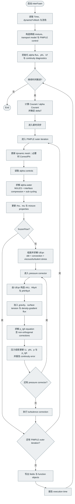
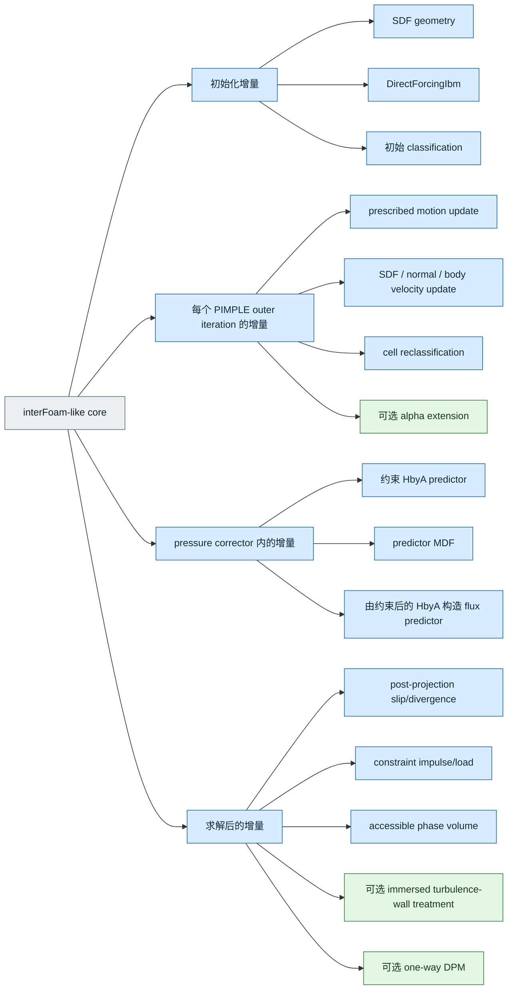
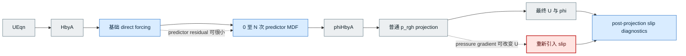

# `interFoam` 与 `ichiBoundaryFoam` 的 VoF--IBM 行为流程

日期：2026-11-17

## 1. 图示约定

本文按当前回档后的生产主线记录流程：OpenFOAM-com v2312、cell-based SDF
direct forcing、默认关闭 MDF pressure projection 与 IBM-aware projection。

图中颜色含义如下：

* 灰色：`interFoam` 原有或基本保持一致的 VoF/PIMPLE 流程；
* 蓝色：`ichiBoundaryFoam` 增加的 geometry/IBM 主流程；
* 绿色：编译或 case 控制的可选功能；
* 红色：当前方法的重要限制或诊断节点。

## 2. `interFoam` 的主流程



这个流程的核心约束是普通不可压缩 pressure projection：由压力修正使最终面
通量满足离散连续性。原生 `interFoam` 不存在 immersed geometry，也不要求
内部某个解析表面上的速度等于结构速度。

## 3. 当前 `ichiBoundaryFoam` 的完整主流程

```mermaid
flowchart TD
    A([启动 ichiBoundaryFoam]) --> B[读取 interFoam-like Time、mesh 与流场]
    B --> C[构造两相 mixture、transport model 与 PIMPLE control]
    C --> D[构造 analytic SDF ImmersedGeometry]
    D --> E[构造 cell-based DirectForcingIbm]
    E --> F[按 case/compile flags 构造可选模块]
    F --> G[在初始时刻更新 geometry pose 与 SDF]
    G --> H[初始 cell classification<br/>solid fraction / cell type / forcing cells]
    H --> I[写出初始 geometry fields]
    I --> J{继续时间推进?}

    J -- 否 --> ZZ([End])
    J -- 是 --> K[计算 Courant / alpha Courant<br/>并确定 deltaT]
    K --> L[进入新时间步<br/>IBM beginTimeStep]
    L --> M[进入 PIMPLE outer iteration]
    M --> N[更新 dynamic mesh；必要时 CorrectPhi]

    N --> O[按当前时间更新 prescribed rigid-body pose]
    O --> P[重算 signed distance、normal 与 surface velocity]
    P --> Q[重新进行 IBM cell classification]

    Q --> R[求解 alpha.water<br/>MULES + interface compression + sub-cycling]
    R --> S{启用 alpha extension?}
    S -- 是 --> T[把邻近流体 alpha 延拓到 solid-side cells]
    S -- 否 --> U[更新 mixture properties]
    T --> U

    U --> V{frozenFlow?}
    V -- 是 --> OO{还有 PIMPLE outer iteration?}
    V -- 否 --> W[组装并求解 interFoam-like UEqn]
    W --> X[进入 pressure corrector<br/>IBM beginLoadCycle]
    X --> Y[由 UEqn 构造 rAU 与未投影 HbyA]

    Y --> IB1[基础 direct-forcing correction<br/>HbyA 向 body velocity 靠拢]
    IB1 --> MDF{启用 predictor MDF?}
    MDF -- 否 --> PHI[由 IBM-constrained HbyA 构造 phiHbyA]
    MDF -- 是 --> M1[检查 weighted predictor slip]
    M1 --> M2{达到 tolerance<br/>或用完 correctors?}
    M2 -- 否 --> M3[再次对 HbyA 施加 direct forcing]
    M3 --> M1
    M2 -- 是 --> PHI

    PHI --> AA[加入 ddt correction、gravity、surface tension<br/>和 density-gradient flux]
    AA --> BB[在整个背景网格求解普通 p_rgh equation]
    BB --> CC[普通 pressure projection 更新 U 与 phi]
    CC --> LIMIT[pressure correction 可能重新引入<br/>immersed-surface slip]
    LIMIT --> DD{还有 pressure corrector?}
    DD -- 是 --> X

    DD -- 否 --> EE[报告最终 IBM residuals<br/>constraint slip + divergence]
    EE --> FF[统计 surface-band slip<br/>liquid/gas + normal/tangential]
    FF --> GG[由累计 velocity corrections<br/>报告 constraint impulse/load]
    GG --> HH[报告 IBM-accessible phase volume]
    HH --> II[执行标准 turbulence correction]
    II --> TW{启用 immersed turbulence-wall treatment?}
    TW -- 是 --> JJ[对 SDF wall band 中的 k、omega、nut 施加实验约束]
    TW -- 否 --> OO
    JJ --> OO

    OO -- 是 --> M
    OO -- 否 --> DPM{编入 one-way DPM?}
    DPM -- 是 --> PP[更新 mixture viscosity carrier field<br/>并推进 passive cloud]
    DPM -- 否 --> QQ[写出 fields、geometry/IBM diagnostics<br/>与 function objects]
    PP --> QQ
    QQ --> RR[报告 execution time]
    RR --> J

    classDef core fill:#eceff1,stroke:#546e7a,color:#102027,stroke-width:1px;
    classDef ibm fill:#d9ecff,stroke:#1565c0,color:#0d2a42,stroke-width:1.5px;
    classDef optional fill:#e4f7e7,stroke:#2e7d32,color:#173b1a,stroke-width:1px;
    classDef warning fill:#ffe4e1,stroke:#c62828,color:#5b1111,stroke-width:2px;

    class A,B,C,J,K,L,M,N,R,U,V,W,X,Y,PHI,AA,BB,CC,DD,II,OO,QQ,RR,ZZ core;
    class D,E,G,H,I,O,P,Q,IB1,MDF,M1,M2,M3,EE,FF,GG,HH ibm;
    class F,S,T,TW,JJ,DPM,PP optional;
    class LIMIT warning;
```



## 4. `ichiBoundaryFoam` 相对 `interFoam` 增加的位置



## 5. 当前标准 MDF 路线的关键顺序

默认编译配置为：

```text
ENABLE_MDF_PRESSURE_PROJECTION = 0
ENABLE_IBM_AWARE_PROJECTION    = 0
```

因此当前生产路线是：



所以日志中的：

```text
Predictor MDF corrector ... max slip = 0
```

只说明 pressure projection 前的 weighted predictor constraint 已经很小；判断
时间步最终的 immersed constraint 质量，应读取：

```text
IBM projection residuals
IBM surface-band slip
IBM surface-band components
```

## 6. 方法定位

`ichiBoundaryFoam` 不是在整个 `interFoam` 时间步完成后直接覆盖一次 `U`。
IBM 先修正 `HbyA`，普通 pressure equation 因而能够看到 IBM-modified velocity
predictor。这个做法比时间步末强行设置 `U = Ub` 更能保持 pressure/flux
consistency。

但是，当前路线仍是顺序耦合：

```text
VoF / momentum predictor
    -> cell-based IBM forcing / MDF
    -> ordinary full-domain pressure projection
```

immersed velocity constraint 与 discrete continuity 并没有作为同一个联立系统
求解。因此 solver 可以长期保持 VoF/PIMPLE 稳定和有界，却仍在最终 pressure
projection 后留下显著 slip，特别是 tangential slip。

当使用：

```bash
make pure-interfoam
```

编译时，geometry、SDF、IBM forcing、IBM diagnostics 和上述可选 IBM 模块都不
构造；程序直接回到官方 v2312 `UEqn.H` 与 `pEqn.H` 路径，可作为 fluid-only
回归基线。

## 7. Progress meeting：本周工作方向

### 7.1 会议后的任务概括

本周可能需要准备三项相互关联、但应明确分开的工作：

1. 为 cylinder/monopile 增加一种更有物理意义的简化 prescribed motion；
2. 复刻 Roulund、Sumer、Fredsøe 与 Michelsen (2005) 的经典圆桩 benchmark；
3. 结合现有模型能力、benchmark 和运动结构方向，完成一份小型应用前景 review。

建议把三者组织为：

```text
fixed-pivot prescribed motion
    -> 展示 moving-body WSI 的应用能力

Roulund rigid-bed benchmark
    -> 检验 fixed-pile RANS、近床流动与 horseshoe vortex

application review/report
    -> 说明模型当前能做什么、不能做什么，以及下一步为何值得做
```

这里不能把三项都笼统称为 FSI。当前结构运动由 case 预先给定，载荷不反馈到
结构动力学，因此准确名称仍是 **prescribed moving-body WSI**；Roulund
benchmark 本身则是 fixed-pile current--structure hydrodynamics/scour benchmark。

### 7.2 固定地下转轴的结构运动

#### 当前实现的不足

当前 `harmonic6DoF` 分别给定 cylinder centre 的平移和绕 centre 的旋转。
`ImmersedGeometry` 使用：

$$
\boldsymbol U_b(\boldsymbol x,t)
=
\boldsymbol V_c(t)
+
\boldsymbol\omega(t)\times
[\boldsymbol x-\boldsymbol C(t)].
$$

因此仅设置 pitch 而不设置 translation 时，cylinder 会绕自身中心摆动，不会绕
海床以下的固定 foundation/pivot 倾转。

#### 建议的 pivot kinematics

给定固定转轴点 $\boldsymbol P$、初始 cylinder centre $\boldsymbol C_0$ 和姿态
$\boldsymbol R(t)$，centre 应由旋转自动决定：

$$
\boldsymbol C(t)
=
\boldsymbol P
+
\boldsymbol R(t)
[\boldsymbol C_0-\boldsymbol P].
$$

若 pivot 本身静止，则：

$$
\boldsymbol V_c(t)
=
\boldsymbol\omega(t)\times
[\boldsymbol C(t)-\boldsymbol P],
$$

从而任一点的表面速度可化为：

$$
\boldsymbol U_b(\boldsymbol x,t)
=
\boldsymbol\omega(t)\times
[\boldsymbol x-\boldsymbol P].
$$

这能保证 pivot 在整个运动过程中严格不动。对于初始沿 $z$ 轴的竖直圆桩，
绕全局 $y$ 轴取正 pitch 会使桩顶向 $+x$ 方向倾倒。

#### 运动形式 A：绕 pivot 简谐摆动

可沿用现有 harmonic law：

$$
\theta(t)
=
\theta_0
+
A\sin[2\pi f(t-t_0)+\phi].
$$

它适合研究 motion/wave frequency ratio、phase difference、振幅以及运动对 wake
和载荷的周期调制。

#### 运动形式 B：在多个波周期内缓慢倒塌

不建议直接采用突然启停的 constant angular velocity。对于从 $\theta_0$ 平滑
过渡到 $\theta_f$ 的单次倾倒，可令：

$$
s
=
\operatorname{clamp}
\left(\frac{t-t_0}{T_f},0,1\right),
$$

$$
\theta(t)
=
\theta_0
+
(\theta_f-\theta_0)
(10s^3-15s^4+6s^5).
$$

该 quintic smoothstep 在开始和结束时同时具有零角速度与零角加速度，适合让
monopile 在几十至上百个波周期中缓慢向 $+x$ 倾倒，并在完成后保持最终姿态。

#### 建议实现和验证顺序

1. 为 `RigidBodyMotion` 增加固定 `pivot` 的几何关系；
2. 先实现 pivoted harmonic pitch；
3. 再实现 `smoothCollapse` 或更通用的 smooth ramp rotation；
4. 编写不求解 CFD 的解析运动学 tester，检查：
   * pivot 位置恒定；
   * centre 轨迹与解析解一致；
   * cylinder axis/rotation angle 正确；
   * surface velocity 满足刚体运动；
   * 起止角速度和角加速度符合配置；
5. 进行小网格、单相、短时间 smoke test；
6. 进行 V1m 风格的 laminar VoF 测试；
7. 再进入 R1m 风格的 `kOmegaSST` 测试；
8. 短测试通过后才运行几十至上百周期的 collapse case。

### 7.3 Roulund et al. (2005) benchmark 的准确定位

目标论文为：

> A. Roulund, B. M. Sumer, J. Fredsøe & J. Michelsen (2005),
> “Numerical and experimental investigation of flow and scour around a
> circular pile”, *Journal of Fluid Mechanics*, 534, 351--401,
> DOI: `10.1017/S0022112005004507`.

可核对来源：

* [DTU publication record](https://orbit.dtu.dk/en/publications/numerical-and-experimental-investigation-of-flow-and-scour-around-2/)
* [JFM paper PDF](https://electronicsandbooks.com/edt/manual/Magazine/J/Journal%20of%20Fluid%20Mechanics/2005%20Volume%20534/S0022112005004507.pdf)

这篇论文不是 moving-cylinder FSI 或 regular-wave WSI benchmark。它研究固定竖直
圆桩在 steady current 下的三维流动、horseshoe vortex、lee-wake、bed shear
stress 和后续 live-bed scour。原数值模型使用 `k-omega` closure，并明确没有
free-surface facility，主要适用于较低 Froude number。

因此当前阶段应将它表述为：

> a canonical three-dimensional current--pile hydrodynamics and scour
> benchmark, used to validate the fixed-structure flow model before
> extending it to prescribed moving-pile WSI.

### 7.4 第一阶段：只复刻 rigid smooth-bed hydrodynamics

本周不应直接从 morphodynamic scour 开始。最合适的第一目标是论文 rigid-bed
experiment 的 Test 1：

| 参数 | Test 1 |
|---|---:|
| bed | smooth rigid bed |
| water depth $h$ | $0.54\,\mathrm m$ |
| boundary-layer thickness $\delta$ | $0.54\,\mathrm m$ |
| mean approach velocity $V$ | $0.326\,\mathrm{m/s}$ |
| pile diameter $D$ | $0.536\,\mathrm m$ |
| pile Reynolds number $Re_{D,V}$ | $1.7\times10^5$ |
| Froude number | $0.14$ |

论文的主要可比较量包括：

* upstream/downstream symmetry plane 的 velocity field；
* $z=0.5,1,2,5,10,20\,\mathrm{cm}$ 处的 $u$ 与 $w$ profiles；
* pile pressure coefficient；
* upstream symmetry line 的 bed shear stress amplification；
* horseshoe-vortex size、position 和 topology；
* lee-wake circulation。

建议建立两层算例：

#### Roulund-BF

* body-fitted pile；
* 真实 ground/pile wall patches；
* 与实验一致的 incoming boundary layer；
* `kOmegaSST`；
* 先复现 velocity、pressure、bed shear 和 horseshoe vortex。

#### Roulund-IBM

* 使用相同 domain、inlet profile、fluid properties 和 sampling；
* 将 pile 替换为 SDF/cell-based IBM；
* 比较远离 forcing band 的 velocity 与 vortex structure；
* 同时报告 slip、divergence、forcing-band resolution 和 constraint load；
* 在 wall closure 未验证前，不把 IBM wall shear 作为主要成功标准。

Roulund benchmark 会直接检验当前模型较弱的部分：ground--pile junction、
immersed no-slip、horseshoe vortex、RANS wall distance 与 bed shear。因此复刻
结果可能首先表明现有 IBM 不能准确给出近壁量；这仍是需要如实记录的技术
结论，而不是应通过调整措辞隐藏的问题。

### 7.5 暂不直接复刻 live-bed scour

论文 Test 3 使用 loose sand，并将 steady hydrodynamic model 与二维 bed-load
transport、surface-layer sand slide 和 evolving morphology 耦合。当前项目的
one-way DPM scaffold：

* 不向 Eulerian fluid 反馈 momentum 或 particle volume；
* 没有 SDF-aware pile collision；
* 没有 packed sediment bed；
* 没有 erosion/deposition criterion；
* 没有 angle-of-repose sand slide；
* 没有 evolving bed morphology。

所以它不能直接复刻 Roulund Test 3。live-bed scour 应被列为 benchmark
hydrodynamics 通过后的中长期扩展，而不是本周最低交付。

### 7.6 小型应用前景 review/report

报告建议控制在约 4--6 页，并围绕当前模型的真实成熟度组织，而不是泛泛介绍
IBM 或把所有未来功能都写成已有能力。

建议结构为：

1. **Background and motivation**
   * offshore monopile 与 wave/current loading；
   * installation、foundation failure、collapse 和 decommissioning；
2. **Current numerical platform**
   * `interFoam`-like VoF；
   * Stokes waves；
   * SDF/cell-based MDF；
   * static/prescribed-motion cylinder；
   * laminar/RANS 与现有 diagnostics；
3. **Demonstration problem 1**
   * fixed-pivot harmonic motion 或 slow collapse；
4. **Validation problem**
   * Roulund rigid-bed fixed-pile benchmark；
5. **Application prospects**
   * prescribed moving-monopile WSI；
   * collapse/failure-induced free-surface and wake response；
   * motion-modulated transverse loading；
   * wave--current interaction；
   * future scour-risk indicators；
6. **Current limitations**
   * prescribed motion，不是双向 FSI；
   * post-projection slip；
   * immersed SST wall closure 不完整；
   * constraint load 不是完整 surface-stress integration；
   * 没有 morphodynamics/DEM；
7. **Verification and development roadmap**
   * pivot motion tester；
   * BF/IBM Roulund comparison；
   * moving laminar/RANS tests；
   * 再决定 wall treatment、load closure 或 sediment development。

### 7.7 本周建议交付顺序

1. 冻结 fixed-pivot motion 的字典接口和数学定义；
2. 实现 pivoted harmonic motion；
3. 实现 smooth-collapse trajectory；
4. 完成运动学 tester 与小型 CFD smoke test；
5. 整理 Roulund Test 1 的 geometry、boundary-layer inlet 和 sampling
   specification；
6. 建立 body-fitted Roulund-BF 模板；
7. 在 BF 可运行后复制为 Roulund-IBM 对照；
8. 用当前 solver 状态、运动案例与 benchmark 计划完成小型应用前景报告。

优先级上，应先完成 motion kinematics 与 rigid-bed hydrodynamic benchmark，
而不是同时开始 two-way FSI、immersed wall-model 重写和 morphodynamic scour。
这样即使高级扩展尚未完成，本周仍能交付可运行的运动模型、明确的 benchmark
specification 和一份不夸大现有能力的技术报告。
